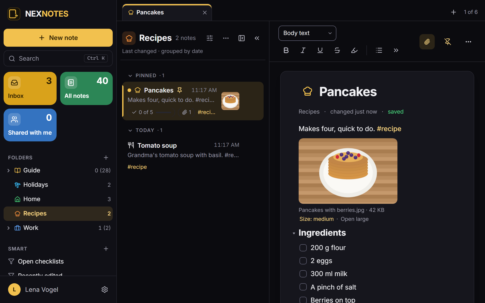
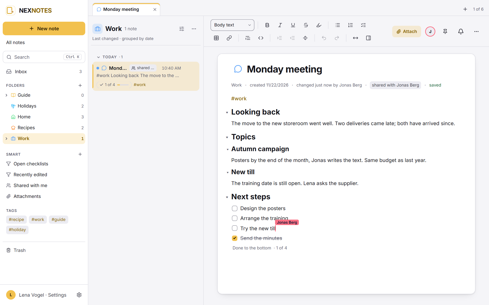
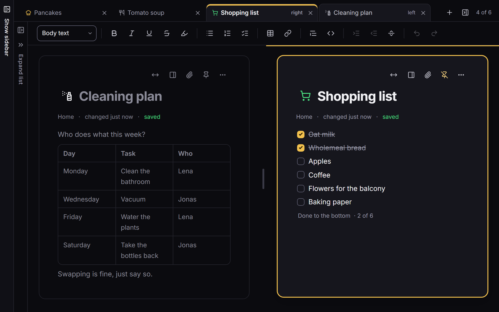
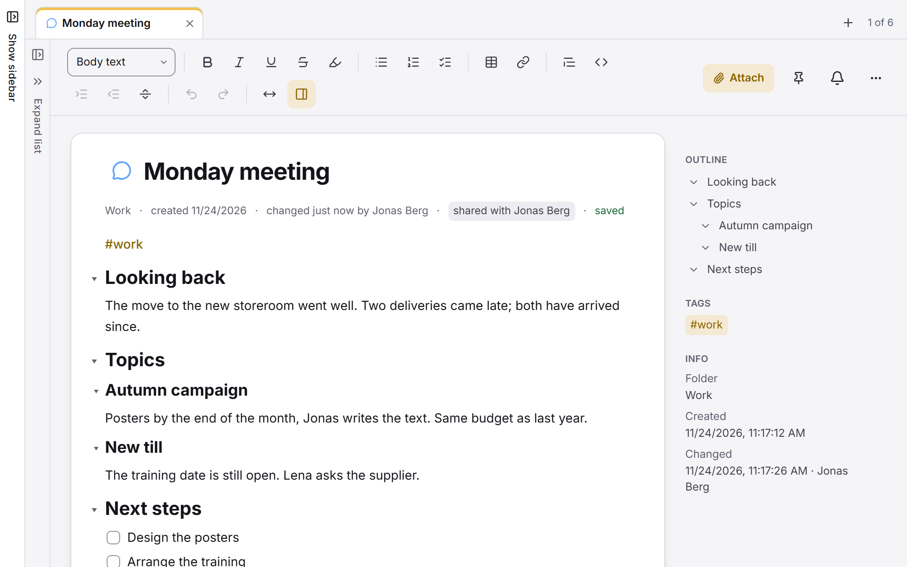
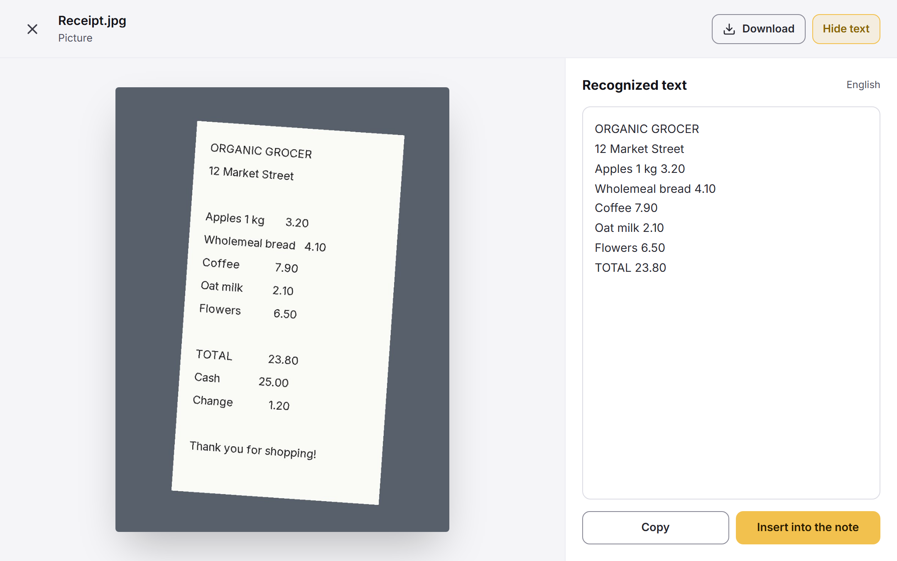
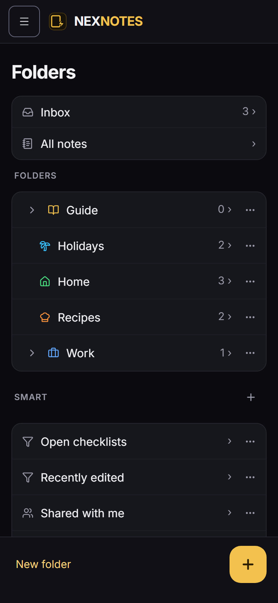

<p align="center">
  
</p>

# nexnotes

Quick notes on your own server. Write a thought down in a second, find it again in a year, and share a shopping list
or a meeting note with the people who write in it with you, live. In the browser, on the phone as a web app, and
soon on iPhone and iPad.

nexnotes has a calm look of its own: honey as the one accent, notes on a quiet paper, light and dark.

**1.1.0** is the current release. Keep backups all the same, see [Backup](#backup).



*A note with a picture and a checklist. On the left the tiles for the inbox, all notes and what others share with
you, then folders with their own symbol and colour and the smart folders; in the middle the notes of the folder,
pinned ones first.*

## Screenshots



*Shared notes are edited together, live: everybody sees the others' cursors and changes as they type.*



*Tabs like in a browser (Alt-click opens a note in a new one), and two notes side by side.*



*The sidebar and the list fold away to narrow strips, and the note gets the whole width, with its outline beside it.*

<p>
  
  
</p>

*Text in photos, scans and PDFs is recognised on the server and found by the search. On a phone nexnotes shows one
view at a time and installs from the browser as an app.*

## What it does

- **Notes that write themselves out of the way.** A new note starts with its title; formatting by toolbar, by
  Markdown as you type or by the bar at selected text: headings that fold, checklists that move what is done to the
  bottom, tables, code, highlights, links that become a card. An outline beside long notes, a paper and a symbol per
  note.
- **Live together.** Every note is a shared document (Yjs): people with access write at the same time, with their
  cursors and names, and nothing is ever overwritten.
- **Order without effort.** An inbox for what has no place yet, folders and subfolders with symbol and colour,
  `#tags` written right in the text, pins and colours, and **smart folders** built from conditions (tag, folder, open
  checklists, attachments, changed in the last days, shared with me, …).
- **Four ways to show a list**: list, cards, compact and tiles, sorted and grouped by date per folder.
- **Several notes at once**: tabs, Alt-click for a new tab, two notes side by side; the sidebar and the list fold
  away and give the note the whole width.
- **Search** over titles, text, tags and the recognised text of attachments, from anywhere with Ctrl+K.
- **Attachments**: photos, PDFs, videos and other files by dragging, pasting or choosing; pictures in three sizes, PDFs
  to leaf through, videos that play in the note, a gallery of every attachment. **Text recognition** (Tesseract, nine
  languages in the image) reads photos, scans and PDFs in the background. Sketches and voice recordings made in the
  iPhone and iPad app show in the browser, the recording with its text running along.
- **Sharing** a note or a folder with other accounts, to read or to write, and **read links** for people without an
  account, each with a last day, revocable at once.
- **Notifications** for a shared note or folder: who changed what, bundled once nobody has written for two minutes,
  in every browser that allowed them (Web Push) and in the iOS app.
- **The vault** for secrets: a locked note is encrypted on the device before it leaves it (end to end). Neither the
  server nor its operator can read it.
- **History and trash**: earlier versions of every note with the names of who wrote, to restore or to keep as a copy;
  deleted notes and folders stay in the trash for 90 days (both periods set by the operator).
- **Export** of a note as Markdown (a ZIP with its attachments) or as a PDF set on the server with
  [Typst](https://typst.app); a folder or everything as a ZIP of Markdown files in their folders.
- **Connections**: send a line or a whole checklist to [nextasks](https://github.com/DerKezorm/nextasks) as tasks; a
  [nexdeck](https://github.com/DerKezorm/nexdeck) card with pinned notes or a checklist to tick off; an **MCP**
  endpoint for AI tools, with a key or by OAuth with the member's consent.
- **An API** for programs and scripts under `/api/v1`, with its own description at `/api/v1/docs`, see
  [For programs](#for-programs).
- **On the phone**: one view at a time, installable as a web app; on Android nexnotes appears in the share menu, and
  what another app shares lands in the inbox.
- **A guide as the first content**: every account starts with a folder "Guide" that explains nexnotes with pictures,
  in its own language.
- **Accounts** by invitation only, sign-in with username or email, passkeys, a second factor (TOTP with recovery
  codes), a list of the devices you are signed in on, a forgotten password by mail, profile pictures, sign-in through
  any number of OpenID Connect providers side by side.
- **For the operator**: backups every night, to download, upload and restore; a log in four levels; a page that says
  what nexnotes takes on the disk; switches for read links, link previews, the API, MCP and password sign-in.
- **Languages**: English and German, plus languages of your own as JSON files.

An iPhone and iPad app for nexnotes is coming to the App Store.

## Start

```yaml
services:
  nexnotes:
    image: ghcr.io/derkezorm/nexnotes:latest
    container_name: nexnotes
    restart: unless-stopped
    ports:
      - "8570:8000"
    volumes:
      - ./data:/data
    environment:
      PUID: 1000
      PGID: 1000
      TZ: Europe/Berlin
```

Then `docker compose up -d`. Images for `linux/amd64` and `linux/arm64` are on the GitHub Container Registry, one tag
per release (`1.1.0`, also `1.1`) and `latest`. The [docker-compose.yml](docker-compose.yml) in this repository has the same service
with every option explained; it builds from source with `docker compose up -d --build`.

Open `http://<your-host>:8570`. The first account you create there becomes the operator. It needs the **setup code**
from the server's log, so that nobody who reaches a fresh instance first can take it over:

```
docker logs nexnotes
```

To choose the code yourself, set `NEXNOTES_SETUP_TOKEN`. Further accounts come by invitation, under
**Settings › Server › Accounts**.

Locked out as the operator? A link to set a new password comes from inside the container:

```
docker exec -u nexnotes nexnotes python -m app.emergency reset-link <username or email>
```

## Behind a reverse proxy

Put nexnotes behind a reverse proxy with TLS before you use it from anywhere but your own desk. Two settings matter:

```yaml
    environment:
      NEXNOTES_PUBLIC_URL: https://notes.example.com
      NEXNOTES_TRUSTED_PROXIES: 172.16.0.0/12
```

- `NEXNOTES_PUBLIC_URL` is the address people use. Invitation links, read links and the redirect address of the
  sign-in providers carry it. It can also be set in the settings; the setting there wins.
- `NEXNOTES_TRUSTED_PROXIES` names the proxy (addresses or networks, comma separated). Only from there does nexnotes
  believe `X-Forwarded-For` and `X-Forwarded-Proto`. Without it every sign-in seems to come from the proxy, so the
  brake against password guessing cannot tell people apart, and nexnotes does not see that it is reached over https.

**The proxy must pass WebSockets through.** Every open note keeps one at `/api/notes/<id>/live`; without it a note
cannot be edited. nexnotes accepts the connection only from its own page, so the proxy must also pass the `Host`
header (or `X-Forwarded-Host`), or the public address must be set.

- **nginx**: `proxy_http_version 1.1;`, `proxy_set_header Upgrade $http_upgrade;`,
  `proxy_set_header Connection "upgrade";`, `proxy_set_header Host $host;` and a `proxy_read_timeout` of a few
  minutes.
- **Nginx Proxy Manager**: switch on "Websockets Support" for the host.
- **Caddy** and **Traefik** pass WebSockets on their own.

For attachments, allow request bodies as large as the largest upload (100 MB by default, set in the server
settings), for example `client_max_body_size 110m;` in nginx.

## Sign-in with a provider

The operator adds any number of OpenID Connect providers (authentik, Microsoft Entra ID, Keycloak, Authelia, Pocket
ID and others) in the settings, each with a button of its own on the sign-in page. For authentik there is a one-step
setup that registers nexnotes there.

- The redirect address to register at the provider is built from the public address; set that first.
- An account is linked to a provider by the provider's own identity, never by a mail address. People link their
  account themselves in their settings, or come in through an invitation.
- Password sign-in can be switched off for members once everybody signs in through a provider; the operator keeps it
  as the way in when a provider fails.

## Where things are stored

Everything lives in `/data`: the SQLite database `nexnotes.db`, the files of attachments in `attachments/`,
`secret.key`, `backups/`, `exports/`, `logs/` and `locales/`. Mount it from a local disk, never from an SMB or NFS
share: SQLite's locking does not work reliably over network filesystems, and nexnotes warns about a data folder on a
network share.

`secret.key` protects what the server must read on its own: the client secrets of the sign-in providers, the mail
password, the seeds of second factors and the key of Web Push. When `NEXNOTES_SECRET_KEY` is set, it is used instead.
Notes in the vault are encrypted on the device; neither the key nor a backup opens them.

### Backup

Back up with nexnotes's own backups under **Settings › Server › Storage and backups**: every night from the start
(seven kept), every week or only by hand, and one before every update. They copy the database consistently while it runs, together with the attachments and `secret.key`, into
one ZIP with a checksum for every file. A backup holds everything; keep downloaded copies as carefully as the data
folder itself. Exports in `exports/` are in no backup.

Moving to a new server: download a backup, set up nexnotes there, upload the backup there, check it and
restore it. The restore happens at the next start, and the state before it is kept as a backup of its own.

## Updating

```
docker compose pull
docker compose up -d
```

Make a backup first (see above). What changed is in the release notes.

## Environment

| Variable | Default | Meaning |
|---|---|---|
| `NEXNOTES_DATA_DIR` | `/data` | Database, attachments, backups, exports, logs, languages |
| `NEXNOTES_PUBLIC_URL` | from the request | The address people use, see above. The setting in the interface wins when set |
| `NEXNOTES_TRUSTED_PROXIES` | none | Reverse proxies whose `X-Forwarded-For` and `X-Forwarded-Proto` are believed, comma separated |
| `NEXNOTES_SETUP_TOKEN` | made at start | The code the first account needs, at least 16 characters (a shorter one is ignored, the log says so) |
| `NEXNOTES_SECOND_FACTOR_OFF` | none | Emergency only: `true` asks nobody for a second factor (passkey or code) until it is removed. The log warns while it is set |
| `NEXNOTES_SECRET_KEY` | `secret.key`, made at the first start | Protects server-side secrets; when set, it wins over `secret.key` |
| `NEXNOTES_OPERATOR_NETWORKS` | none | Networks the operator's settings may be changed from, comma separated. Empty: anywhere |
| `NEXNOTES_SESSION_DAYS` | `30` | A browser stays signed in at most this many days (1 to 3650) |
| `NEXNOTES_COOKIE_SECURE` | `auto` | `auto` (from the request, or from a trusted proxy), `true` or `false` |
| `NEXNOTES_COOKIE_SUFFIX` | none | Appended to the cookie names when two instances share a host: letters, digits and `_` |
| `NEXNOTES_LOG_LEVEL` | stored setting | `quiet`, `normal`, `detailed` or `trace`; overrides the setting |
| `NEXNOTES_PUSH_RELAY` | `https://push.nexapps.dev` | The relay that hands notifications to Apple for the iOS app. It sees only what is encrypted for the device. Empty: nothing goes out |
| `NEXNOTES_APPLE_APP_IDS` | `6KQSFL9GA3.dev.nexapps.nexnotes` | Apps whose links to notes open in the app instead of the browser (`/.well-known/apple-app-site-association`), comma separated. Only for an address the app was built with. Empty: no file |
| `NEXNOTES_GUIDE` | `true` | Every account gets the folder "Guide". `false`: only who asks for it under **Settings › My account › Appearance** |
| `NEXNOTES_LOCALES_DIR` | `<data>/locales` | Where your own language files lie |
| `NEXNOTES_API_DOCS` | `false` | Also serves FastAPI's own `/api/docs` and `/api/openapi.json` (the API for programs has its description at `/api/v1/docs` either way) |
| `NEXNOTES_MEDIA_MEMORY_MB` | `1024` | Memory one worker for pictures, PDFs and videos may take, at least 256 |
| `NEXNOTES_PORT` | `8000` | Port inside the container, for host networking |
| `TZ` | `UTC` | The time zone of the log |
| `PUID`, `PGID` | `1000` | Owner of the files in the data folder; never 0 |

A variable with a value nexnotes cannot use stops the start with a line in the log that names the variable and the
values it takes. Mail (for invitations and password resets), the largest upload, text recognition languages, read
links, the API and MCP are set in the interface.

## For programs

Home Assistant, n8n or your own scripts use nexnotes over `/api/v1`: folders, notes, tags, smart folders, search,
attachments, and making, changing and ticking off in notes. Every account makes its own API keys under
**Settings › My account › Connections › API keys**, to read or to read and write, for all notes or chosen folders, with an end
date. A browser with nexnotes open shows every route with a `curl` example at `/api/v1/docs`; the reference is in
[docs/api.md](docs/api.md).

```
curl -H "Authorization: Bearer $NEXNOTES_TOKEN" https://notes.example.com/api/v1/me
```

What is under `/api/v1` stays: new fields may come, nothing is renamed or taken away. A change that would break a
program goes to `/api/v2` beside it.

**MCP**: an API key with "Also for AI tools (MCP)" opens `/api/mcp` for tools that speak the Model Context Protocol; a
tool can also connect itself by OAuth, with the member's consent. The operator can switch MCP off for the whole server.

## Languages

nexnotes speaks English and German and follows the browser unless an account picks a language. Put a language file
(`nl.json`, same keys as the English one) into `<data>/locales` and restart: it is offered in the language menu,
marked as yours. What a file leaves out shows in English.

## Security in short

- Passwords are hashed with Argon2id. Wrong passwords slow down whoever guesses, per name and per sender. A second
  factor makes the password alone useless.
- Every changing request of the browser needs the header `X-Nexnotes-Client`, which a page on another site cannot
  send; the live connection of a note is accepted only from nexnotes's own page.
- Notes in the vault are encrypted on the device; the server keeps only what it cannot read.
- Notifications to the iOS app and to browsers are encrypted for the device before they leave.
- What somebody may not see answers exactly like what does not exist.
- The log never contains note contents, passwords, keys or tokens.
- Once a day nexnotes asks GitHub whether a newer release is out; only the question goes out. It can be switched off
  in the settings.

Report a vulnerability privately, see [SECURITY.md](SECURITY.md).

## Development

```
cd backend && python -m venv .venv && .venv/Scripts/python -m pip install -r requirements-dev.txt
.venv/Scripts/python -m uvicorn app.main:app --port 8570
cd frontend && npm ci && npx vite
```

Python 3.14 and Node 22, the versions of the image and the CI. On Linux the virtual environment's programs are in `.venv/bin`. The frontend on port
5570 sends `/api` to the backend on 8570. Tests: `python -m pytest -q` in `backend`, `npx vitest run` in `frontend`,
the browser tests with `npm run e2e`.

## License

AGPL-3.0, see [LICENSE](LICENSE). What nexnotes ships or depends on, with its licence, is listed in
[THIRD-PARTY.md](THIRD-PARTY.md).
